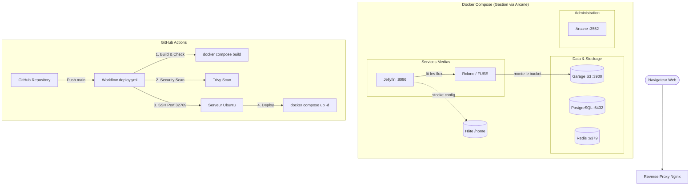

# Projet de Streaming VOD

Ce dépôt contient l'infrastructure d'une plateforme de streaming VOD conçue en micro-services. Le projet tourne sous Docker Compose pour faciliter le déploiement, combinant une architecture de services interconnectés, l'intégration de Jellyfin adossé à un stockage objet S3 via Rclone, ainsi qu'une chaîne de déploiement continu (CI/CD) automatisée avec GitHub Actions.

## Architecture globale

Voici la modélisation de l'architecture de la plateforme :



## Stack Technique

- **Serveur Multimédia** : Jellyfin (Port 8096) pour la gestion et la lecture de la bibliothèque VOD.
- **Pont de Stockage** : Rclone assurant le montage FUSE du stockage objet S3 en tant que répertoire local (`./media`) avec gestion des collisions (`--allow-non-empty`).
- **Stockage Objet** : Garage S3 (Port 3900) pour la conservation décentralisée des flux vidéos.
- **Base de données & Cache** : PostgreSQL pour les métadonnées et Redis pour la gestion des données transitoires.
- **Administration** : Arcane (Port 3552) pour le monitoring et la supervision locale des conteneurs.
- **CI/CD & Sécurité** : GitHub Actions, Trivy (Scanner de vulnérabilités), `appleboy/ssh-action` (Déploiement SSH automatisé).

## Intégration & Déploiement Continus (CI/CD)

Le projet intègre un workflow automatisé via GitHub Actions situé dans `.github/workflows/deploy.yml`.

### Étapes du Pipeline :
1. **Déclencheur (Push)** : Déclenchement automatique lors d'un `push` sur la branche `main`.
2. **CI - Compilation & Validation** : Vérification de la syntaxe et build des images avec `docker compose build`.
3. **CI - Scan de Sécurité avec Trivy** : Analyse automatique des configurations à la recherche de vulnérabilités.
4. **CD - Connexion SSH** : Connexion sécurisée au serveur Ubuntu distant via `appleboy/ssh-action` sur le port externe redirigé `32769`.
5. **CD - Déploiement Automatisé** : Récupération du code (`git pull origin main`), démarrage/recréation des conteneurs (`docker compose up -d --build --force-recreate`).
6. **CD - Vérification Healthcheck** : Contrôle du statut des conteneurs après démarrage (`docker compose ps`).

### Variables d'environnement (GitHub Secrets) :
- `SERVER_HOST` : Adresse IP publique / nom de domaine du serveur.
- `SERVER_USER` : Utilisateur SSH exécutant Docker.
- `SSH_PRIVATE_KEY` : Clé privée SSH (format OpenSSH, sans passphrase).

## Procédure de Connexion Git et Déploiement

### 1. Configuration de Git sur la machine

Si tu récupères le projet sur une nouvelle machine, configure d'abord ton identité Git :

```bash
git config --global user.name "Ton Nom"
git config --global user.email "ton.email@exemple.com"
```

### 2. Clonage du Dépôt

```bash
git clone https://github.com/noe-cha/Streaming-docker-project /Streaming-docker-project
cd /Streaming-docker-project
```

## Comment lancer le projet manuellement

1. **Initialiser la configuration d'environnement** :
   ```bash
   cp .env.exemple .env
   ```

2. **Lancer la stack avec politique de redémarrage automatique** :
   Tous les services sont configurés avec `restart: always` pour garantir leur redémarrage automatique en cas de reboot du serveur.

   ```bash
   docker compose up -d
   ```

3. **Accès aux interfaces** :
   - **Jellyfin (Lecteur & Administration VOD)** : `http://<IP_WAN>:8096`
   - **Arcane (Dashboard de gestion)** : `http://<IP_WAN>:3552`
   - **Garage S3 API** : `http://<IP_WAN>:3900`

## Notes et problèmes rencontrés

- **Redirection de port SSH non standard (32769 -> 22)** :
  En raison d'une plage de ports attribuée restreinte au niveau de la box internet, l'accès SSH au serveur s'effectue via le port externe `32769` redirigé vers le port `22` du serveur hôte. Le paramètre `port: 32769` a été spécifié dans l'action SSH de la CI/CD.

- **Gestion des permissions Docker & Git sur l'hôte** :
  Afin d'autoriser l'exécution de Docker et Git par l'agent CI/CD sans élévation de privilèges (`sudo`) :
  - Ajout de l'utilisateur au groupe Docker : `sudo usermod -aG docker $USER`
  - Déclaration du dossier comme répertoire sûr pour Git : `git config --global --add safe.directory /Streaming-docker-project`

- **Contraintes d'espace disque sur les partitions Debian** :
  L'hôte présente une restriction d'espace sur la partition `/var`. Le problème a été résolu en déportant le volume de configuration de Jellyfin (`./jellyfin-config`) directement sur la partition `/home`.

- **Gestion des points de montage FUSE avec Rclone** :
  Des conflits de verrouillage de dossiers déjà montés lors des redémarrages de conteneurs ont été neutralisés par l'intégration de l'argument `--allow-non-empty` dans la commande de montage Rclone.