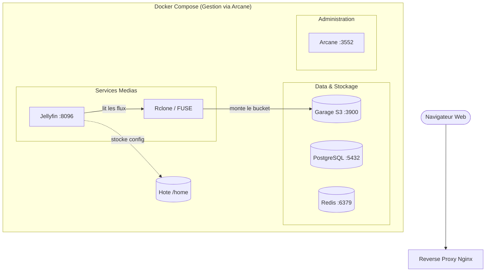

# Projet de Streaming VOD

Ce depot contient l infrastructure d une plateforme de streaming VOD concue en micro-services. Le projet tourne sous Docker Compose pour faciliter le deploiement, combinant une architecture de services interconnectes et l integration de Jellyfin adosse a un stockage objet S3 via Rclone.

## Architecture globale

Voici la modelisation de l architecture de la plateforme :



## Stack Technique

* **Serveur Multimedia** : Jellyfin (Port 8096) pour la gestion et la lecture de la bibliotheque VOD.

* **Pont de Stockage** : Rclone assurant le montage FUSE du stockage objet S3 en tant que repertoire local (`./media`) avec gestion des collisions (`--allow-non-empty`).

* **Stockage Objet** : Garage S3 (Port 3900) pour la conservation decentralisee des flux videos.

* **Base de donnees & Cache** : PostgreSQL pour les metadonnees et Redis pour la gestion des donnees transitoires.

* **Administration** : Arcane (Port 3552) pour le monitoring et la supervision locale des conteneurs.

## Procedure de Connexion Git et Deploiement

### 1. Configuration de Git sur la machine

Si tu recuperes le projet sur une nouvelle machine (ou un nouveau conteneur Proxmox), configure d abord ton identite Git :

```bash
git config --global user.name "Ton Nom"
git config --global user.email "ton.email@exemple.com"
```

### 2. Clonage ou Initialisation du Depot

Si le depot existe deja sur GitHub/GitLab :

```bash
git clone https://github.com/noe-cha/Streaming-docker-project /Streaming-docker-project
cd /Streaming-docker-project
```

Si tu pars d un dossier local vide et que tu veux l initialiser et le lier a un depot distant :

```bash
cd /Streaming-docker-project
git init
git remote add origin https://github.com/noe-cha/Streaming-docker-project
git branch -M main
```

## Comment lancer le projet

1. **Initialiser la configuration d environnement** :
   Creer et configurer le fichier `.env` a la racine avec les identifiants requis :

   ```bash
   cp .env.exemple .env
   ```

2. **Lancer les services** :

   ```bash
   docker compose up -d
   ```

3. **Acces aux interfaces** :

   * **Jellyfin (Lecteur & Administration VOD)** : `http://<IP_WAN>:8096`

   * **Arcane (Dashboard de gestion)** : `http://<IP_WAN>:3552`

   * **Garage S3 API** : `http://<IP_WAN>:3900`

## Notes et problemes rencontres

* **Contraintes d espace disque sur les partitions Debian** :
  L hote Debian presente une fragmentation des partitions avec un espace restreint sur `/var`, provoquant des erreurs de seuil critique (exigences de 2 Go par Jellyfin). Le probleme a ete resolu en deportant le volume de configuration de Jellyfin (`./jellyfin-config`) directement sur la partition `/home` (beneficiant d un espace de stockage confortable).

* **Gestion des points de montage FUSE avec Rclone** :
  Des conflits de verrouillage de dossiers deja montes lors des redemarrages de conteneurs ont ete neutralises par l integration de l argument `--allow-non-empty` dans la commande de montage Rclone. .